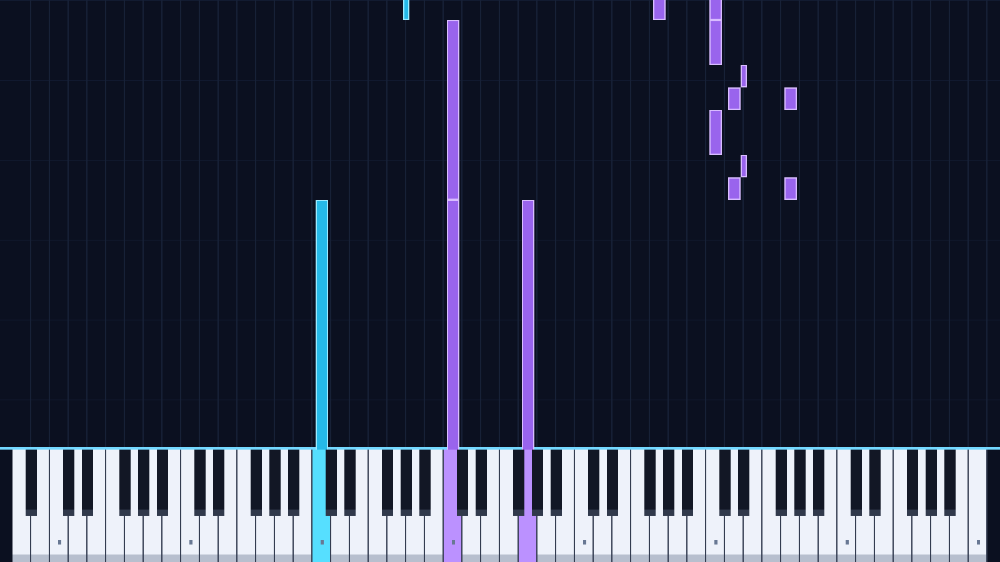

# 1600×900 / 88 键钢琴瀑布流

适用于 Tang Mega 60K SOM + TANG MEGA NEO Dock，器件
`GW5AT-LV60PG484AC1/I0`（GW5AT-60B）。打开 `dvi_photo.gprj` 构建。

## 目前的效果

- 1600×900、60 Hz、24-bit RGB，底部完整显示 A0～C8 共 88 键。
- 52 个白键各宽 30 像素，键盘从 x=20 到 x=1579；36 个黑键宽 18 像素，
  按真实钢琴的两个/三个黑键组叠在白键上方。没有把屏幕均分成 88 列。
- 键盘上沿 y=720，白键高 180 像素、黑键高 106 像素。
- 上方青色/紫色光块对准各琴键中心，长度表示音长；到达键盘时亮键，
  音符结束后恢复原色。支持和弦、重复同音和最多 64 个可见音符。
- 光块使用片上两位音高位图；在垂直消隐期清空、重建，显示期只读，
  无需外部帧缓存。同音重叠通过按位合并保留内部/边框，光块横向不重叠。
- 当前谱面直接取自 `../GW_PROBLEM_TOW/sd_card/PIANO.BIN` 的《克罗地亚狂想曲》钢琴版，
  不是重新分析录音或用随机音符替代。3721 条事件还原为 1860 个音符，原文件时间线 202.706 秒。
- 每帧下落 4 像素，音符从顶部到键盘用 180 帧（3 秒）。源文件第 t 秒的起音在动画启动后
  t+3 秒到达琴键；加上文件尾部时间和 1.5 秒循环间隔，动画约 207.20 秒循环。
- 曲目用到 63 个不同琴键，键盘仍保留完整 88 键；最高 6 音同时按下、45 个光块同时在途。
  本文件音符时间恰好落在 60 Hz 帧网格上，起止时刻转换误差为 0 ms。
- 上电自动运行，无需 SD 卡。此版本实现显示动画，尚未连接钢琴音频播放或演奏判分。
  青/紫色以中央 C 分区，并非原谱的左右手声部分离。
- 当前仍为独立显示工程，没有与 `GW_PROBLEM_TOW` 的 SD 播放控制/音频时钟联动；
  两个独立启动的工程不会自动同步。音符时间已保留，可在后续合并时接入统一播放时间。



[动画预览](waterfall_preview.gif) 来自相同谱面与几何布局的参考渲染；
`preview.png` 的第 200 帧另外与真实 RTL 仿真输出逐像素对照。

## 操作及下载

- `KEY2`：低有效复位，重新开始动画。
- 按住 `KEY0`：显示 1600×900 彩条；松开恢复动画。切换在垂直消隐期进行，
  动画时间持续运行。

Gowin IDE 中执行综合及 Place & Route，下载
`impl/pnr/dvi_photo.fs` 到 FPGA SRAM。命令行构建：

```powershell
& 'D:\Gowin\Gowin_V1.9.12.03_x64\IDE\bin\gw_sh.exe' .\dvi_photo\tools\build.tcl
```

引脚沿用本工程原有的 NEO Dock DVI 输出约束 `src/dvi_photo.cst`。
通过数字 DVI-D 或兼容的 HDMI 转 DVI-D 线连接显示器。
输出为 DVI 视频，不携带 HDMI 音频数据包。尚未做本版本的板上实测。

## 时序与时钟

采用 VESA DMT 0x53 的 1600×900 / 60 Hz 时序：

| 项目 | 有效 | 前肩 | 同步 | 后肩 | 总计 |
| --- | ---: | ---: | ---: | ---: | ---: |
| 水平 | 1600 | 24 | 80 | 96 | 1800 |
| 垂直 | 900 | 1 | 3 | 96 | 1000 |

HS、VS 均为正极性，像素时钟 108 MHz；每通道 TMDS 数据率 1.08 Gbit/s。
板上 50 MHz 输入经 PLLA：`IDIV=1, MDIV=27, ODIV0=2.5`，
VCO=1350 MHz，输出 540 MHz；CLKDIV /5 得到 108 MHz。
保留高云提供的 GW5AT-60B PLL 启动校准模块。
RGB 和 DE/HS/VS 在绘图模块中同步延迟五个像素时钟；TMDS 编码另外采用三级流水线，
控制信号与像素同步延迟。光块和亮键状态只在垂直消隐期更新。

时序参数参考 [Linux DRM 的 DMT 表](https://github.com/torvalds/linux/blob/master/drivers/gpu/drm/drm_edid.c)，
PLL 参数依据安装的高云原语库及 [Arora V 时钟手册](https://cdn.gowinsemi.com.cn/UG306E.pdf)。

## 文件组织

| 文件 | 用途 |
| --- | --- |
| `src/video_clock.v` | PLLA、启动校准与像素分频 |
| `src/video_source.v` | 1600×900 扫描、同步信号与帧更新脉冲 |
| `src/piano_scene.v` | 琴键、光块、亮键、彩条及绘图流水线 |
| `src/piano_roll_bitmap.v` | 在消隐期生成音高×扫描行位图，像素路径同步查表 |
| `src/waterfall_engine.v` | 帧时间、64 个音符槽、循环谱面与 88 位亮键状态 |
| `src/piano_keymap.v` | 逐列的白键/黑键映射 ROM，由工具生成 |
| `src/piano_score_rom.v` | 谱面 ROM，由工具生成 |
| `src/score_config.vh` | 音符数量、循环帧数 |
| `tools/generate_waterfall.py` | 生成 ROM、谱面与独立测试数据 |
| `tools/render_waterfall.py` | 参考画面、GIF 及 RTL 图像对照 |

没有复制 GitHub 项目的 RTL 或厂商特定 VGA IP；实现以本工程原有 DVI 链路为基础。
谱面/落块组织参考了 [fpga-hero](https://github.com/cwilkens/fpga-hero) 的思路。
旧静态照片的 `photo_rom.v`、图片数据及 `prepare_image.py` 保留，但不再加入当前综合。

## 仿真

在项目根目录执行：

```powershell
.\tools\simulate.ps1
```

脚本优先使用本机 ModelSim（默认 `F:\Quartus\modelsim_ase\win32aloem`）；
可通过 `-ModelSimBin` 指定目录，或通过 `-IcarusBin` 使用 Icarus。
Python 需要 Pillow、NumPy，默认优先使用 Codex 随附运行时；也可传 `-PythonExe`。
回归会从相邻 `GW_PROBLEM_TOW/sd_card/PIANO.BIN` 重新生成当前曲目的 ROM 和测试参考。
转换输入的 SHA256 与逐音符起止/力度/声部记录保存在 `score_report.json`。
还可运行 `python -m unittest discover -s sim -p test_score_bin.py -v`，
核对二进制头、坏数据拒绝、逐音符还原与帧时间转换。

验证包括：8192 组 TMDS 数据和控制码、88 键到达/结束时刻、和弦、音符槽回收与循环、
完整 144 万像素画面、全部黑白键的亮键颜色，以及完整 1800×1000 扫描与消隐时序。
使用官方 PLL/CLKDIV 模型的时钟验证另运行：

```powershell
& 'F:\Quartus\modelsim_ase\win32aloem\vsim.exe' -c -l sim/clock.log -do sim/clock.do
```

该测试使用硬件版本启动等待时间；不能用缩短到 8 微秒的 `SIM` 等待常量搭配
需要 50 微秒锁定的官方 PLL 模型，否则会在锁定前结束校准窗口。
`clock.do` 中的高云安装路径可按实际位置修改。

## 替换谱面

默认从现有钢琴 Bin 生成（不会修改原 Bin）：

```powershell
python tools/generate_waterfall.py
```

指定其他同格式 P88S 文件或恢复原来的 88 键练习演示：

```powershell
python tools/generate_waterfall.py --bin 'C:\path\to\PIANO.BIN'
python tools/generate_waterfall.py --demo
```

P88S 使用 voice 配对 note-on/note-off，保留每个音符的起止时刻、音高和和弦；
文件中已包含延音效果，无需再次读取 MIDI。错误文件头、截断、乱序时间、
非法音高/声部、未配对关音或缺少结束记录都会报错。

转换 MIDI（需要 `mido`，脚本也会查找相邻 `Piano_88/tools/vendor`）：

```powershell
python tools/generate_waterfall.py --midi 'C:\path\to\piano.mid'
```

随后重新构建。转换保留音高、起止时间、和弦和 CC64 延音，忽略打击乐通道，
只显示 MIDI 21～108。时间按 60 帧/秒量化；落块提前三秒出现。
最多 4095 个音符、65535 帧、64 个同时可见音符，超过限制或位图重建超出消隐期预算时，转换器会明确报错。
P88S/MIDI 都在电脑端转为画面 ROM，暂未实现显示端 SD 读谱或音频合成。
运行默认仿真脚本会恢复当前《克罗地亚狂想曲》Bin 谱面；自定义谱面需在仿真后重新生成再构建。

## 本次构建与验证结果

2026-10-24，Gowin V1.9.12.03 综合、布局布线及码流生成成功。
50 MHz 系统域和 108 MHz 像素域的数据路径建立/保持违例均为 0；
像素域报告 Fmax 108.506 MHz，时序余量较小。使用 6520/59904 逻辑、
3314/60780 寄存器、25/118 BSRAM、4 个 OSER10。
`tools/build.tcl` 会自动检查数据路径建立时间，有违例时构建报错。

报告仍有 4 个异步复位恢复端点和 4 个 OSER10 复位移除端点告警，
以及板载 sys_clk 输入普通布线的 PR1014 警告。未把这些路径添加为例外隐藏；
数据路径检查通过不等于整个复位/物理链路已经验证。需要板上确认上电锁定、
复位恢复和显示稳定性，本次没有向板卡下载。

ModelSim 回归检查 TMDS 编码与三级对齐、完整曲目时间线、88 键状态、
63360 个音高/扫描行位图单元、重复同音合并、上下裁切、全部键的亮键与相邻键隔离、
完整 1600×900 RGB 图像和完整扫描帧。默认截图对照的音符运动时刻为第 200 帧；
截图测试加速跳过未观测的起始时间，完整起始/循环时间线由独立调度测试覆盖。
官方 PLL/CLKDIV 模型验证通过，像素/串行周期分别约 9.260/1.852 ns（仿真精度）。

本次沿用并覆盖原码流 `impl/pnr/dvi_photo.fs`，没有另建曲名码流或下载到板卡。
当前码流 SHA256：`8d0c6aab9e7b9d05690f076f225de4e8f7c67baeba07919d659183d31b9604a6`。
原 `PIANO.BIN` SHA256：`81f10ba6dcd06f2af75f02d276c1f1e057ded1bfc5c80793e9b7790e93a0f663`。
谱面来源与署名沿用 `../GW_PROBLEM_TOW/source/ATTRIBUTION.md`。
